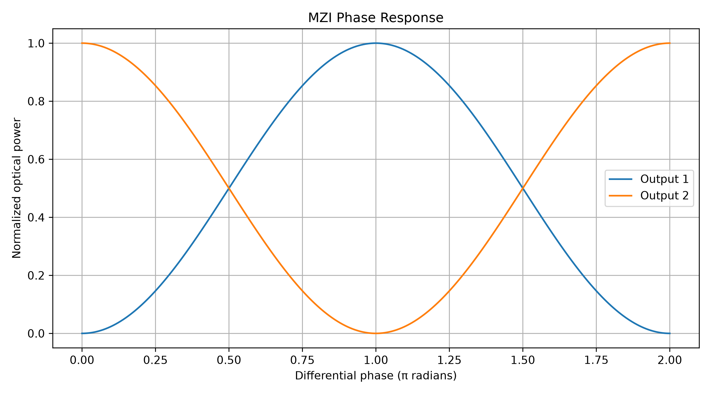
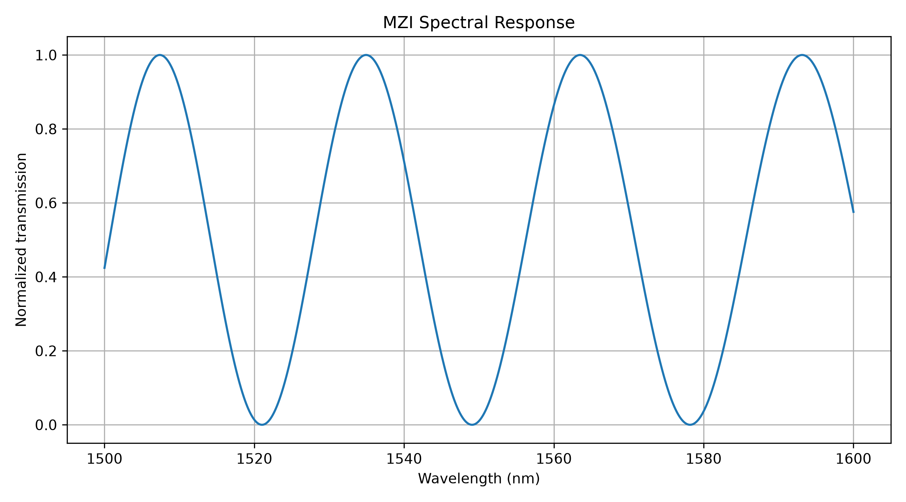
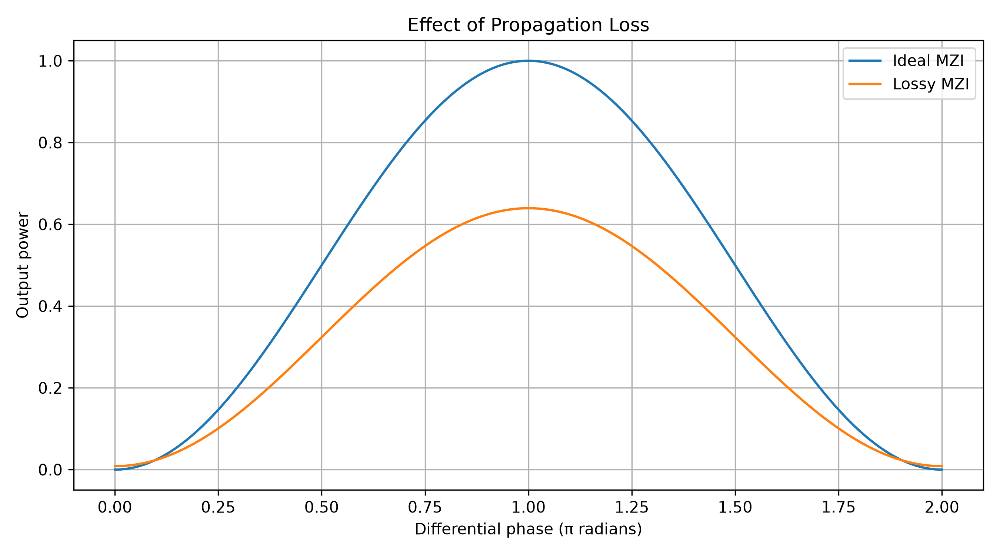

# Photonic Interferometer Simulator

A Python-based transfer-matrix simulation of a Mach–Zehnder
Interferometer (MZI), designed to investigate phase modulation,
optical interference, spectral response and device performance.

## Features

- 2x2 directional coupler modelling
- Complex optical field propagation
- Differential phase modulation
- Voltage-controlled phase response
- Wavelength-dependent spectral response
- Free Spectral Range (FSR) calculation
- Coupler imbalance analysis
- Propagation loss modelling
- Extinction ratio and insertion loss
- Analytical and numerical validation

## Mathematical Model

The complete MZI is represented by:

    E_out = C2 @ P @ C1 @ E_in

where:

- C1 and C2 represent directional couplers
- P represents phase accumulation in the two arms
- E_in represents the input optical field
- E_out represents the output optical field

For ideal balanced couplers, the output transmission is:

    T1 = (1 - cos(Delta_phi))/2
    T2 = (1 + cos(Delta_phi))/2

The wavelength-dependent phase is modelled as:

    Delta_phi(lambda) = 2*pi*n_eff(lambda)*Delta_L/lambda

The local free spectral range is approximated by:

    FSR = lambda^2/(n_g*Delta_L)

## Technologies

- Python 3
- NumPy
- SciPy
- Matplotlib

## Installation

Clone the repository:

    git clone https://github.com/Iman-Sukul0011/photonic-interferometer-simulator.git

Enter the project directory:

    cd photonic-interferometer-simulator

Create a virtual environment:

    python3 -m venv .venv
    source .venv/bin/activate

Install dependencies:

    pip install -r requirements.txt

## Run

    python src/mzi_simulator.py

## Project Structure

    photonic-interferometer-simulator/
    ├── src/
    │   └── mzi_simulator.py
    ├── results/
    │   ├── phase_response.png
    │   ├── voltage_response.png
    │   ├── spectral_response.png
    │   ├── coupler_sensitivity.png
    │   ├── loss_analysis.png
    │   ├── spectral_data.csv
    │   └── performance_report.txt
    ├── docs/
    │   └── theory.md
    ├── requirements.txt
    ├── README.md
    └── .gitignore

## Validation

The ideal MZI model was tested against its analytical
transfer function.

Observed numerical errors:

- Analytical error: 5.551e-16
- Energy conservation error: 6.661e-16

The simulated spectral peak spacing was also compared
with the wavelength-dependent theoretical FSR.

## Model Assumptions and Limitations

This is a lumped transfer-matrix model, not a full
electromagnetic simulation.

The model uses:
- First-order effective-index dispersion
- Wavelength-independent directional couplers
- Linear voltage-to-phase conversion
- Independent propagation losses in the two arms

It does not yet model fabrication variations,
temperature dependence, polarization effects,
or nonlinear optical behaviour.

## Research Motivation

This project explores the physics of integrated photonic
interferometers as a foundation for further investigation
of hybrid electronic-photonic computing architectures.

## Author

Iman Sukul

Integrated M.Sc. Physics and Astronomy
National Institute of Technology Rourkela

---

## Simulation Results

### 1. Phase Response
Output power as a function of the phase difference between the two interferometer arms.

### 2. Spectral Response
Wavelength-dependent transmission showing the interference pattern and free spectral range.

### 3. Propagation Loss Analysis
Effect of propagation losses on the interferometer output.

